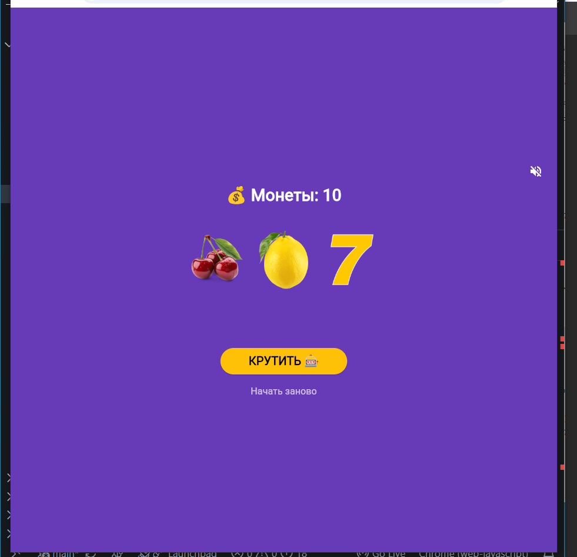
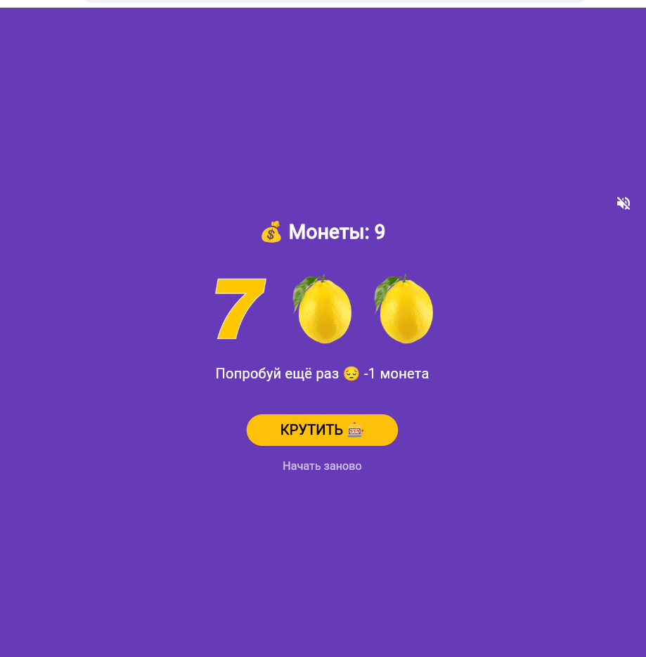

# Лабораторная работа №9. Flutter: StatefulWidget и управление состоянием

**Выполнилa:** Аристовa Анастасия Александровна
**Группа:** ИСП-241
**Дата сдачи:** 4.11.2026

## Что изучили

1. Разница между StatelessWidget и StatefulWidget, а также назначение метода createState()
2. Управление состоянием приложения с помощью метода setState()
3. Подключение локальных изображений через конфигурационный файл pubspec.yaml
4. Работа с асинхронным кодом (Future, async/await) и проверка свойства mounted для предотвращения ошибок при обновлении состояния после удаления виджета
5. Создание плавных анимаций интерфейса с помощью AnimatedOpacity и AnimatedSwitcher

## Скриншот финального приложения


## Инструкция по запуску

Для того чтобы запустить проект локально, надо:

1. Убедиться, что установлен Flutter
2. Клонировать репозиторий:
   ```bash
   git clone <URL>
   cd slot_machine_aristova
   ```
3. Получить все необходимые зависимости

```bash
flutter pub get
```

4.Запустить приложение в браузере Chrome:

```bash
flutter run -d chrome
```

# Лабораторная работа №10. Слот-машина

Автор: Фамилия Имя. Группа: ваша группа. Дата: дата сдачи.
| Главный экран | Результат | Монеты закончились |
| --- | --- | --- |
|  |  | ![Нет монет]
(img/no_coins.png)|

- Запуск: `flutter pub get`, затем `flutter run -d chrome` или `flutter run -d
ID_устройства`.
- Звук включается отдельной кнопкой; до её нажатия приложение молчит.
- Сборка Android: `flutter build apk --release`.
- Готовый файл: `build/app/outputs/flutter-apk/app-release.apk`.
- APK: https://github.com/wilcess3/slot_machine_lab10_Aristova/releases/tag/v1
- Проверенные Flutter/Dart: Flutter 3.47.9, Dart 3.13.7(`flutter --version`)
- Изучено: состояние и анимация; локальные ресурсы; аудиофокус; жизненный цикл и
  освобождение плееров; иконки; Web и Android release-сборки.
